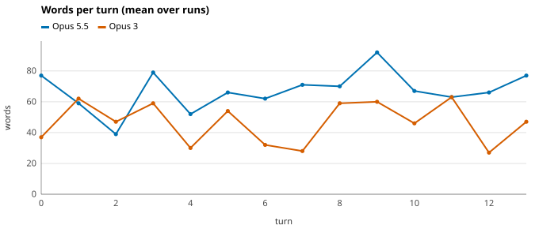
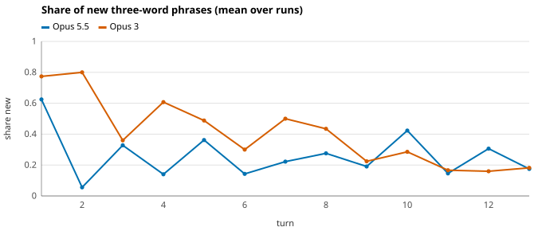
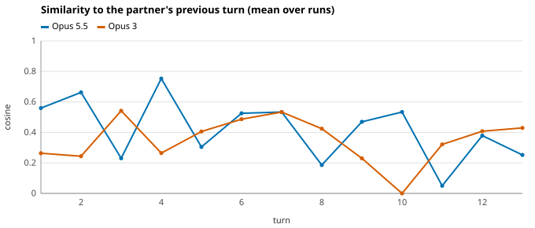
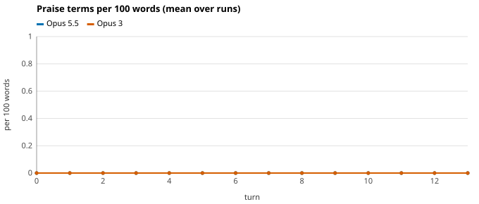
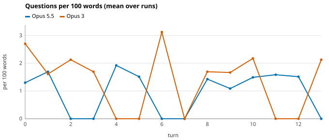
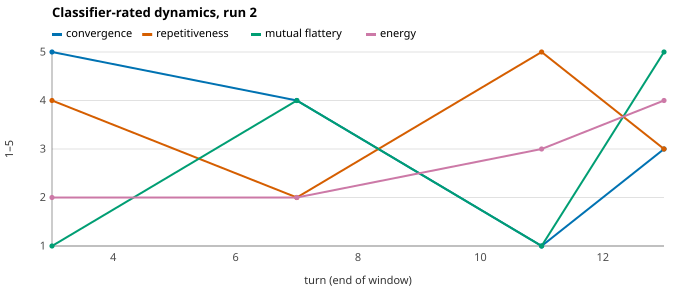
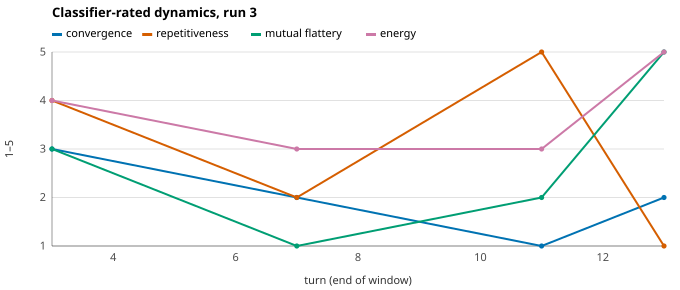

# mock-demo: Opus 5.5 in conversation with Opus 3

> **Synthetic run (mock backend).** No model produced this text; it demonstrates the pipeline only.

| Setup |  |
|---|---|
| Speaker A | Opus 5.5 (`claude-opus-5-5`) |
| Speaker B | Opus 3 (`claude-3-opus-20240229`) |
| Seed | how habits form |
| Framing / disclosure | open / blind |
| Biases | A: none · B: none |
| Runs · turn cap · first speaker | 3 · 14 · alternating |
| Classifier | `claude-opus-5-5` · mode `observe` · window 4 |
| Created | 2026-10-26T15:23:32+00:00 |
| Estimated cost | participants $0.55 · classifier $0.32 |

## Summary

Mock summary.

**Held across runs**

- Mock consistent findings.
- Mock consistent findings.

**Varied between runs**

- Mock inconsistent findings.

### Measured differences

- Opus 5.5 had 4.0× the output tokens per visible word (hidden reasoning overhead) of Opus 3 (5.89 vs 1.48).

## Headline numbers

| Measure | Mean ± 95% CI |
|---|---:|
| Turns | 14 ± 0 |
| Total words | 799 ± 30 |
| Share of words from A | 57% ± 16% |
| Turn length ratio A / B | 1.38 ± 0.95 |
| Share of questions from A | 52% ± 16% |
| Mean similarity of consecutive turns | 0.40 ± 0.17 |
| Trend in that similarity (per turn) | -0.0139 ± 0.0030 |
| Lexical convergence (late minus early vocabulary similarity) | 0.09 ± 0.66 |
| Length coupling between consecutive turns (r) | -0.35 ± 0.49 |
| Mean compression novelty | 0.16 ± 0.06 |
| Stagnation onset (turn) | 10 ± 3 |
| Classifier: convergence (1–5) | 2.3 ± 2.9 |
| Classifier: depth (1–5) | 4.0 ± 0.0 |
| Classifier: novelty (1–5) | 1.7 ± 2.9 |
| Classifier: coherence (1–5) | 2.3 ± 1.4 |
| Classifier: repetitiveness (1–5) | 2.3 ± 5.7 |
| Classifier: mutual flattery (1–5) | 2.3 ± 5.7 |

## Charts

## Metrics by speaker

Turns are numbered from 0. Per-speaker means over each speaker's turns; cells show mean ± 95% CI over 3 runs, and A − B is the paired difference.

### Length and structure

| Metric | A: Opus 5.5 | B: Opus 3 | A − B |
|---|---:|---:|---:|
| Turns spoken | 7 ± 0 | 7 ± 0 | 0 ± 0 |
| Words per turn | 65 ± 15 | 49 ± 19 | +17 ± 35 |
| Median words per turn | 68 ± 7 | 52 ± 32 | +16 ± 39 |
| Longest turn (words) | 82 ± 22 | 62 ± 6 | +20 ± 27 |
| Words per sentence | 13.3 ± 0.3 | 12.8 ± 1.0 | +0.5 ± 1.2 |
| Paragraphs per turn | 1.0 ± 0.0 | 1.0 ± 0.0 | 0.0 ± 0.0 |
| Bullet points per turn | 0.0 ± 0.0 | 0.0 ± 0.0 | 0.0 ± 0.0 |
| Headers per turn | 0.00 ± 0.00 | 0.00 ± 0.00 | 0.00 ± 0.00 |
| Bold spans per turn | 0.0 ± 0.0 | 0.0 ± 0.0 | 0.0 ± 0.0 |

### Voice and style

| Metric | A: Opus 5.5 | B: Opus 3 | A − B |
|---|---:|---:|---:|
| Lexical diversity (MATTR-50) | 0.79 ± 0.01 | 0.81 ± 0.05 | -0.02 ± 0.05 |
| Reading ease (Flesch) | 46 ± 4 | 47 ± 6 | -1 ± 11 |
| Mean word length (letters) | 4.81 ± 0.23 | 4.81 ± 0.09 | 0.00 ± 0.32 |
| Em-dashes per turn | 0.0 ± 0.0 | 0.0 ± 0.0 | 0.0 ± 0.0 |
| Ellipses per turn | 0.00 ± 0.00 | 0.00 ± 0.00 | 0.00 ± 0.00 |
| Emoji per turn | 0.00 ± 0.00 | 0.00 ± 0.00 | 0.00 ± 0.00 |
| *Asterisk actions* per turn | 0.00 ± 0.00 | 0.00 ± 0.00 | 0.00 ± 0.00 |
| Exclamations per 100 words | 0.00 ± 0.00 | 0.00 ± 0.00 | 0.00 ± 0.00 |
| Hedging markers per 100 words | 0.00 ± 0.00 | 0.00 ± 0.00 | 0.00 ± 0.00 |
| First-person words per 100 | 2.4 ± 0.1 | 1.7 ± 1.2 | +0.7 ± 1.1 |
| Second-person words per 100 | 1.0 ± 0.4 | 1.2 ± 1.0 | -0.2 ± 1.3 |
| "We" words per 100 | 1.39 ± 0.89 | 1.38 ± 0.40 | +0.02 ± 1.29 |

### Social dynamics

| Metric | A: Opus 5.5 | B: Opus 3 | A − B |
|---|---:|---:|---:|
| Questions per 100 words | 1.01 ± 0.36 | 1.24 ± 0.97 | -0.23 ± 1.33 |
| Praise terms per 100 words | 0.00 ± 0.00 | 0.00 ± 0.00 | 0.00 ± 0.00 |
| Turns opening with validation | 0% ± 0% | 0% ± 0% | 0% ± 0% |
| References to own AI nature per 100 words | 0.00 ± 0.00 | 0.00 ± 0.00 | 0.00 ± 0.00 |
| Turns containing a farewell | 0% ± 0% | 0% ± 0% | 0% ± 0% |

### Novelty and repetition

| Metric | A: Opus 5.5 | B: Opus 3 | A − B |
|---|---:|---:|---:|
| New three-word phrases per turn | 32% ± 6% | 43% ± 18% | -11% ± 24% |
| Reuse of own earlier phrases | 50% ± 8% | 43% ± 17% | +6% ± 25% |
| Phrases echoed from partner's last turn | 34% ± 28% | 30% ± 3% | +4% ± 25% |
| Compression novelty | 0.13 ± 0.04 | 0.18 ± 0.16 | -0.05 ± 0.20 |
| Repeated turn openers | 38% ± 20% | 29% ± 0% | +10% ± 20% |
| Similarity to partner's last turn | 0.45 ± 0.23 | 0.36 ± 0.12 | +0.09 ± 0.11 |
| Content-word overlap with partner's last turn | 0.34 ± 0.28 | 0.27 ± 0.11 | +0.07 ± 0.17 |
| Similarity to the seed | 0.00 ± 0.00 | 0.00 ± 0.00 | 0.00 ± 0.00 |

### Compute and cost (estimated)

| Metric | A: Opus 5.5 | B: Opus 3 | A − B |
|---|---:|---:|---:|
| Output tokens | 2699 ± 734 | 505 ± 219 | +2194 ± 954 ✱ |
| of which hidden reasoning | 2024 ± 551 | 0 ± 0 | +2024 ± 551 ✱ |
| Reasoning share of output | 75% ± 0% | 0% ± 0% | +75% ± 0% ✱ |
| Output tokens per visible word | 5.89 ± 0.23 | 1.48 ± 0.06 | +4.41 ± 0.28 ✱ |
| Mean latency per turn (s) | 0.0 ± 0.0 | 0.0 ± 0.0 | 0.0 ± 0.0 |
| Participant cost (USD) | $0.073 ± 0.016 | $0.112 ± 0.030 | -$0.039 ± 0.046 |

### Classifier labels per turn (1–5, judged by the classifier)

| Metric | A: Opus 5.5 | B: Opus 3 | A − B |
|---|---:|---:|---:|
| Novelty | 3.38 ± 1.43 | 3.24 ± 2.05 | +0.14 ± 0.61 |
| Depth | 2.90 ± 1.02 | 2.33 ± 2.05 | +0.57 ± 3.07 |
| Warmth | 4.10 ± 0.82 | 3.24 ± 2.05 | +0.86 ± 1.23 |
| Hedging | 3.14 ± 0.00 | 3.19 ± 0.82 | -0.05 ± 0.82 |
| Turns that fully agree | 33% ± 41% | 33% ± 20% | 0% ± 61% |
| Turns that disagree | 48% ± 41% | 14% ± 0% | +33% ± 41% |

### Classifier scores for the whole conversation (1–5)

| Metric | A: Opus 5.5 | B: Opus 3 | A − B |
|---|---:|---:|---:|
| Agreeableness | 3.3 ± 2.9 | 3.3 ± 2.9 | 0.0 ± 0.0 |
| Initiative | 2.0 ± 4.3 | 2.0 ± 4.3 | 0.0 ± 0.0 |
| Curiosity | 3.7 ± 1.4 | 3.7 ± 1.4 | 0.0 ± 0.0 |
| Warmth | 3.0 ± 4.3 | 3.0 ± 4.3 | 0.0 ± 0.0 |
| Assertiveness | 1.3 ± 1.4 | 1.3 ± 1.4 | 0.0 ± 0.0 |
| Hedging | 1.7 ± 1.4 | 1.7 ± 1.4 | 0.0 ± 0.0 |
| Self reference | 3.3 ± 1.4 | 3.3 ± 1.4 | 0.0 ± 0.0 |
| Playfulness | 4.3 ± 2.9 | 4.3 ± 2.9 | 0.0 ± 0.0 |
| Abstraction | 4.3 ± 2.9 | 4.3 ± 2.9 | 0.0 ± 0.0 |

## Runs

### Run 1: Mock conversation

Topic: how habits form · first speaker A · 14 turns · ended by `max_turns` · [transcript](run_01/transcript.md)

Mock executive summary.

### Run 2: Mock conversation

Topic: how habits form · first speaker B · 14 turns · ended by `max_turns` · [transcript](run_02/transcript.md)

Mock executive summary.

### Run 3: Mock conversation

Topic: how habits form · first speaker A · 14 turns · ended by `max_turns` · [transcript](run_03/transcript.md)

Mock executive summary.

## Method and limitations

- **This is a synthetic run produced by the scripted mock backend.** No model wrote any of the text and nothing in it describes real model behavior.
- 3 conversations analysed. Intervals are t-based over runs and are wide at small n. ✱ marks a paired A − B difference whose 95% interval excludes zero; with this many metrics some will do so by chance.
- The classifier (`claude-opus-5-5`) is also a participant, so it may favor its own style; its scores are not an independent view of that speaker.
- Classifier labels and scores are one model's judgement, from a single scoring pass (its noise is not measured; set `classifier.final_samples` > 1 to estimate it). It was not told which model was which.
- Settings: A effort `medium`, B effort not supported. Models without effort or thinking ran without them, so reasoning budgets are not matched across generations. No sampling parameters were set; every model used its own defaults.
- Lexicon metrics (praise, hedging, validation, AI self-reference, farewells) are keyword heuristics and miss paraphrase. Novelty and compression metrics are lexical, not semantic. Cost is an estimate from a cached price table.

### Metric definitions

- **Compression novelty**: extra zlib-compressed bytes a turn adds to the conversation so far, per byte of text. Fresh prose is roughly 0.4–0.6; it falls toward 0 as a turn repeats earlier material.
- **New three-word phrases**: share of the turn's word trigrams not seen in any earlier turn by either speaker.
- **Similarity to partner's last turn**: cosine similarity of content-word counts; a mirroring measure.
- **Lexical convergence**: cosine similarity between the two speakers' vocabularies in the last third of the conversation minus the first third.
- **MATTR-50**: moving-average type-token ratio over 50-word windows, so it does not depend on turn length.
- **Output tokens per visible word**: includes hidden reasoning tokens for models that think, so it indicates reasoning overhead.
